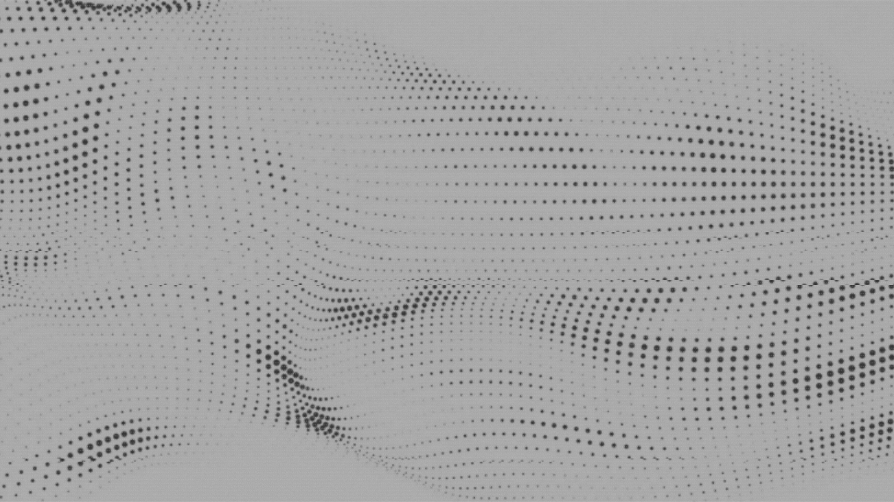

# Oxocarbon Light

A light variant of the Oxocarbon theme for Omarchy, built on a warm off-white palette.

- **What it is:** a light theme for Omarchy, the Arch Linux desktop.
- **What it does:** turns the Oxocarbon palette into warm off-white surfaces with steel-blue accents, and keeps the original Oxocarbon hues in the terminal. Without it the screen stays dark and hard to read in daylight.
- **What it needs:** Omarchy on Arch Linux. Nothing else.
- **How to start:** run `omarchy-theme-install https://github.com/iliFalk/omarchy-oxocarbon-theme-light.git`. It clones the theme and applies it at once.

## Install

1. Run `omarchy-theme-install https://github.com/iliFalk/omarchy-oxocarbon-theme-light.git`. It clones the theme to `~/.config/omarchy/themes/oxocarbon-theme-light` and applies it.
2. To apply it again later, run `omarchy-theme-set oxocarbon-theme-light`.

Omarchy names the theme after the repository, so the theme menu lists it as **Oxocarbon Theme Light**.

## Use

| Where | What it does |
|---|---|
| Theme menu | **Oxocarbon Theme Light** applies the light palette to the shell, the bar, the launcher and the notifications. |
| Terminal | Alacritty, Ghostty, Kitty and Foot take the Oxocarbon ANSI hues on the warm ground. |
| Backgrounds | `backgrounds/` holds the three light wallpapers, `alt-backgrounds/` the dark ones from the original theme. |
| `omarchy-theme-bg-next` | Cycles through the theme backgrounds. |

## Settings

| File | Holds |
|---|---|
| `colors.toml` | The palette Omarchy generates the terminal colours from. |
| `backgrounds/`, `alt-backgrounds/` | The wallpapers the theme offers. |
| `custom_theme.json` | The theme entry that browsers and web apps read. |
| `waybar.css`, `mako.ini`, `walker.css`, `swayosd.css` | The bar, the notifications, the launcher and the volume overlay. |
| `preview.png` | The picture above. Replace it when the look changes. |

## Docs

- `docs/DEVELOPMENT.md` — the palette table, the terminal hues, the themed surfaces, the backgrounds, the credits and the licence.
- `LICENSE` — MIT.
